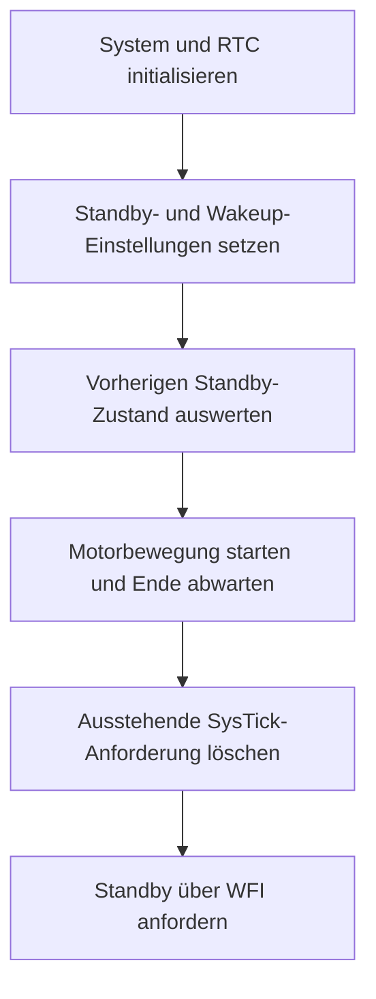

# STM32-Spannungsüberwachung und Standby

Zwei STM32F103-Beispiele für die Versorgungsspannungsüberwachung und einen
stromsparenden Betriebszustand. Das PVD-Beispiel reagiert per Interrupt auf
Schwellwertübergänge. Das Standby-Beispiel konfiguriert RTC, Wakeup-Pin und
Standby-Eintritt nach einer Motorbewegung.

## Enthaltene Anwendungen

| Anwendung | Inhalt |
|---|---|
| `pvd` | Programmierbarer Spannungsdetektor, EXTI-Leitung 16, GPIO-Anzeige |
| `pwr10_standby` | RTC-Konfiguration, Standby, Wakeup-Pin und Startzustandsprüfung |

Es handelt sich um zwei getrennte Firmwareprojekte. Sie werden einzeln gebaut
und dienen unterschiedlichen Versuchen.

## Spannungsüberwachung

`PVD_Init()` aktiviert den PVD und wählt die Stufe über das PLS-Bitfeld.
Steigende und fallende Ereignisse lösen den PVD-Interrupt aus. Der Callback
liest `PVDO` und setzt abhängig davon einen Anzeigeausgang an PB13 oder PC13.
Ein Zahlenwert der tatsächlichen Schaltschwelle ist hier nicht gemessen.

## Standby-Ablauf



Der Code aktiviert den Wakeup-Pin und wertet beim Start das Standby-Flag aus.
Zusätzlich wird ein RTC-Alarmwert vorbereitet; die zugehörige Interruptkonfiguration
ist in dieser Variante auskommentiert. Ein RTC-bedingtes Aufwachen ist deshalb
nicht als geprüftes Verhalten beschrieben.

## Projektaufbau

| Pfad | Inhalt |
|---|---|
| `firmware/pvd/pwr/pwr.c` | PVD-Konfiguration und Anzeige-Callback |
| `firmware/pvd/Core/Src/main.c` | Einstieg des Spannungsversuchs |
| `firmware/pwr10_standby/Core/Src/main.c` | Standby-Eintritt und Ablauf |
| `firmware/pwr10_standby/rtc/` | RTC- und Motortreiberfunktionen |
| `tools/build.py` | Direkter Arm-GCC-Build beider Anwendungen |
| [Hardwarebeschreibung](docs/HARDWARE.md) | Aus dem Code abgeleitete Anschlüsse |
| [Prüfplan](docs/PRUEFPLAN.md) | Vorgesehene Messungen und offene Punkte |

## Bauen

Python 3 und Arm-GCC mit Newlib/Nano-Specs bereitstellen. Der Compiler muss
im PATH liegen; alternativ `ARM_GCC` auf die Compilerdatei setzen.

```powershell
python tools/build.py --project pvd --profile Debug
python tools/build.py --project pvd --profile Release
python tools/build.py --project pwr10_standby --profile Debug
python tools/build.py --project pwr10_standby --profile Release
```

Ausgabe: `build/<Projekt>/<Profil>/firmware.elf`.
Für STM32CubeIDE den jeweiligen Ordner unter `firmware/` als bestehendes
Projekt importieren. Die internen Projektnamen `pvd` und `pwr10_standby`
beibehalten. Ein vollständiger IDE-Import ist noch zu prüfen.

## Entwicklungs- und Prüfstand

Build-Ergebnisse stehen in [BUILD_STATUS.txt](BUILD_STATUS.txt).
Schaltschwelle, Stromaufnahme, Wakeup-Ursache und Verhalten nach erneutem
Einschlafen sind am tatsächlichen Board noch zu messen.

Im PVD-Beispiel werden Anzeigeausgänge gesetzt, aber der jeweils andere Ausgang
wird im Callback nicht zurückgesetzt. Die Anzeige kann deshalb vorherige
Ereignisse behalten. Ein wiederholter Standby-Zyklus ist für diese Kopie ebenfalls
noch nicht nachgewiesen. Die Firmware-Dateien entsprechen dem bereitgestellten Stand.
